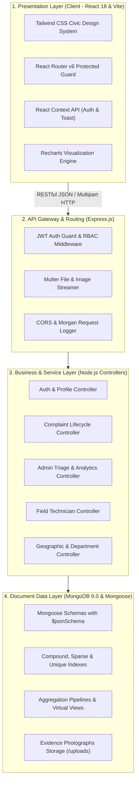
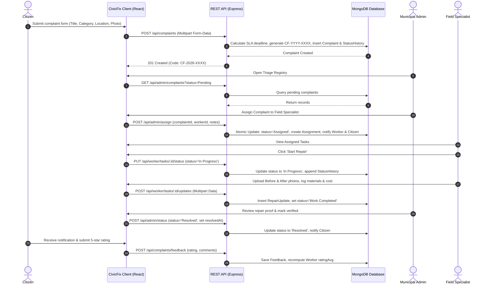
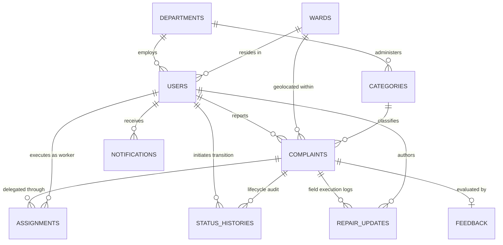

# CivicFix – Public Infrastructure Complaint & Repair Management System
## Comprehensive Technical Project Report & Architectural Documentation

---

### Document Information
- **Project Title**: CivicFix – Public Infrastructure Complaint & Repair Management System
- **Domain**: Civic Technology, Smart City Governance & Public Infrastructure Management
- **Architecture**: MERN Stack (MongoDB, Express.js, React 18, Node.js) with Tailwind CSS
- **Document Version**: 2.0.0 (Production Release)
- **Target Audience**: University Evaluators, Software Architects, and DevOps Engineers

---

## 1. Executive Summary & Abstract

Rapid urbanization and expanding municipal limits have created immense challenges in maintaining public municipal assets—such as roads, stormwater drains, water supply mains, and streetlights. Traditional grievance mechanisms often suffer from opacity, lack of verifiable proof, absent SLA (Service Level Agreement) enforcement, and communication disconnects between citizens, municipal administrators, and field engineering personnel.

**CivicFix** is an enterprise-grade civic technology platform engineered to bridge these gaps. Developed using the **MongoDB, Express.js, React, and Node.js (MERN)** technology stack, CivicFix provides an auditable, role-based platform with three distinct interfaces:
1. **Citizens**: Can capture photos, geolocate infrastructure defects, track resolution progress via an immutable timeline, and provide service ratings.
2. **Municipal Administrators**: Supervise city-wide operations via an executive command dashboard, triage complaints, enforce SLA deadlines, dispatch specialized crews, and analyze live telemetry.
3. **Field Technicians**: Receive digital work orders, update repair progress on-site, log equipment and materials used, and submit before-and-after photographic evidence.

The application adheres strictly to contemporary UI/UX principles (inspired by modern SaaS platforms like Linear and Stripe) and utilizes MongoDB's native JSON schema validation, compound indexes, and multi-stage aggregation pipelines for high-performance municipal data processing.

---

## 2. System Architecture & High-Level Design

### 2.1 Multi-Tier Architecture Overview

CivicFix is organized into a four-tier architecture ensuring separation of concerns, scalability, and maintainability:



### 2.2 System Modules Description
- **Presentation Layer**: Built with React 18 and Vite for lightning-fast HMR and bundle optimization. Utilizes Tailwind CSS for a custom civic design identity (Deep Navy `#142D4E`, Muted Teal `#168C83`, and Soft Off-White `#F7F8FA`).
- **Security & Authorization Layer**: Stateless authentication using JSON Web Tokens (JWT) stored in secure client storage and verified on each request. Bcrypt with 10 salt rounds hashes user credentials.
- **Service Layer**: Decoupled Express controllers orchestrating business logic, SLA computation, notification dispatch, and file streaming.
- **Persistence Layer**: MongoDB document database enforcing validation rules, referential integrity via ObjectIds, and multi-faceted analytics using `$facet` and `$lookup`.

---

## 3. User Roles & Permission Matrix

CivicFix implements strict Role-Based Access Control (RBAC):

| Feature / Action | Citizen | Municipal Admin | Field Specialist | Public (Guest) |
| :--- | :---: | :---: | :---: | :---: |
| View Public Landing Page & Civic Telemetry | Yes | Yes | Yes | Yes |
| Sign Up / Register Account | Yes | No (Admin managed) | No (Admin managed) | Yes |
| Submit New Infrastructure Complaint | Yes | No | No | No |
| View Personal Complaints List | Yes | No | No | No |
| Reopen / Withdraw Own Complaint | Yes | No | No | No |
| Submit Star Rating & Feedback | Yes | No | No | No |
| Access Executive Command Dashboard | No | Yes | No | No |
| Triage & Reassign Any Complaint | No | Yes | No | No |
| Manage Departments, Wards & Staff | No | Yes | No | No |
| Export Analytical & SLA Compliance Reports | No | Yes | No | No |
| Access Assigned Work Orders Queue | No | No | Yes | No |
| Accept Task & Start Field Repair | No | No | Yes | No |
| Upload Before/After Photographs & Log Costs | No | No | Yes | No |
| Mark Work Completed | No | No | Yes | No |

---

## 4. End-to-End Complaint Lifecycle Workflow



---

## 5. MongoDB Database Design & Data Models

The database layer consists of 10 primary collections with Mongoose schema modeling and `$jsonSchema` document constraints.

### 5.1 Entity Relationship Diagram



### 5.2 Collection Specifications

#### 1. `users`
Represents all system actors with role specialization:
- `_id`: ObjectId (Primary key)
- `email`: String (Unique, Indexed, Lowercase)
- `password`: String (Bcrypt hashed password)
- `role`: Enum (`'citizen'`, `'admin'`, `'field_worker'`)
- `fullName`: String (Required, trimmed)
- `phone`: String (Optional contact)
- `address`: String (Residential or base address)
- `wardId`: ObjectId (Ref: `wards`, for citizens)
- `departmentId`: ObjectId (Ref: `departments`, for workers/admins)
- `employeeCode`: String (Unique identifier for municipal staff)
- `skillSpecialization`: String (Field worker machinery/technical certifications)
- `activeTasksCount`: Number (Current active caseload)
- `completedTasksCount`: Number (Total completed milestones)
- `ratingAvg`: Number (Citizen satisfaction rating out of 5.0)
- `isActive`: Boolean (Default: `true`)
- `timestamps`: `createdAt`, `updatedAt`

#### 2. `departments`
Municipal divisions responsible for specialized infrastructure domains:
- `_id`: ObjectId
- `name`: String (Unique, e.g., 'Roads & Bridges Department')
- `code`: String (Unique, uppercase, e.g., 'DEPT-ROADS')
- `description`: String (Jurisdictional mandate)
- `headName`: String (Executive Commissioner / Chief Engineer)
- `contactEmail`: String
- `helplineNumber`: String
- `budgetAllocated`: Number (Annual operational budget)
- `isActive`: Boolean

#### 3. `wards`
Administrative civic subdivisions with elected council representation:
- `_id`: ObjectId
- `wardNumber`: Number (Unique, e.g., 101)
- `name`: String (e.g., 'Central Promenade')
- `zone`: String (e.g., 'Central Zone', 'North Zone')
- `councillorName`: String
- `councillorPhone`: String
- `officeAddress`: String
- `population`: Number
- `areaSqKm`: Number

#### 4. `categories`
Infrastructure defect classification and SLA definitions:
- `_id`: ObjectId
- `name`: String (e.g., 'Road Damage & Potholes')
- `departmentId`: ObjectId (Ref: `departments`)
- `defaultSlaHours`: Number (Resolution ceiling, e.g., 48, 24, 12)
- `severityLevel`: Enum (`'Low'`, `'Medium'`, `'High'`, `'Urgent'`)
- `description`: String
- `iconName`: String (Lucide icon identifier)

#### 5. `complaints`
Core municipal grievance document:
- `_id`: ObjectId
- `complaintCode`: String (Unique tracking code, e.g., `CF-2026-104921`)
- `citizenId`: ObjectId (Ref: `users`)
- `categoryId`: ObjectId (Ref: `categories`)
- `wardId`: ObjectId (Ref: `wards`)
- `title`: String (Short issue description)
- `description`: String (Detailed description)
- `locationAddress`: String (Street address)
- `landmark`: String (Optional nearby landmark)
- `coordinates`: `{ latitude: Number, longitude: Number }`
- `imageUrl`: String (Path to uploaded evidence photo)
- `priority`: Enum (`'Low'`, `'Medium'`, `'High'`, `'Urgent'`)
- `status`: Enum (`'Pending'`, `'Assigned'`, `'In Progress'`, `'Work Completed'`, `'Resolved'`, `'Rejected'`, `'Reopened'`)
- `assignedWorkerId`: ObjectId (Ref: `users`, null if unallocated)
- `assignedAt`: Date
- `submissionDate`: Date (Default: `Date.now`)
- `resolutionDeadline`: Date (Calculated from `submissionDate + defaultSlaHours`)
- `resolvedAt`: Date (Timestamp when marked verified)
- `adminRemarks`: String

#### 6. `assignments`
Audit log of worker assignments over time:
- `_id`: ObjectId
- `complaintId`: ObjectId (Ref: `complaints`)
- `workerId`: ObjectId (Ref: `users`)
- `assignedByAdminId`: ObjectId (Ref: `users`)
- `status`: Enum (`'Assigned'`, `'Accepted'`, `'In Progress'`, `'Completed'`, `'Reassigned'`)
- `notes`: String
- `assignedAt`: Date
- `completedAt`: Date

#### 7. `statushistories`
Immutable audit log tracking all status transitions:
- `_id`: ObjectId
- `complaintId`: ObjectId (Ref: `complaints`)
- `previousStatus`: String
- `newStatus`: String
- `changedByUserId`: ObjectId (Ref: `users`)
- `remarks`: String
- `changedAt`: Date

#### 8. `repairupdates`
Fieldwork evidence submitted by field technicians:
- `_id`: ObjectId
- `complaintId`: ObjectId (Ref: `complaints`)
- `workerId`: ObjectId (Ref: `users`)
- `updateNotes`: String (Actions taken, e.g., excavation, asphalt laying)
- `beforeImageUrl`: String
- `afterImageUrl`: String
- `materialsUsed`: String
- `costIncurred`: Number
- `updateType`: Enum (`'Progress Note'`, `'Inspection Completed'`, `'Repair In Progress'`, `'Work Finished'`)

#### 9. `feedbacks`
Post-resolution citizen satisfaction evaluations:
- `_id`: ObjectId
- `complaintId`: ObjectId (Ref: `complaints`, Unique)
- `citizenId`: ObjectId (Ref: `users`)
- `rating`: Number (1 to 5)
- `satisfactionLevel`: Enum (`'Very Unsatisfied'`, `'Unsatisfied'`, `'Neutral'`, `'Satisfied'`, `'Very Satisfied'`)
- `comments`: String
- `submittedAt`: Date

#### 10. `notifications`
In-app alerts for state updates and assignments:
- `_id`: ObjectId
- `userId`: ObjectId (Ref: `users`)
- `complaintId`: ObjectId (Ref: `complaints`, Optional)
- `title`: String
- `message`: String
- `isRead`: Boolean (Default: `false`)
- `notificationType`: String

---

## 6. Advanced MongoDB Aggregation Pipelines

CivicFix replaces traditional relational SQL queries with optimized MongoDB aggregation pipelines:

### 6.1 Department-Wise Caseload & Resolution Velocity Pipeline
```javascript
db.departments.aggregate([
  {
    $lookup: {
      from: 'categories',
      localField: '_id',
      foreignField: 'departmentId',
      as: 'deptCategories'
    }
  },
  {
    $lookup: {
      from: 'complaints',
      localField: 'deptCategories._id',
      foreignField: 'categoryId',
      as: 'complaints'
    }
  },
  {
    $project: {
      departmentName: '$name',
      code: '$code',
      headName: '$headName',
      totalComplaints: { $size: '$complaints' },
      resolvedCount: {
        $size: {
          $filter: {
            input: '$complaints',
            as: 'c',
            cond: { $eq: ['$$c.status', 'Resolved'] }
          }
        }
      },
      inProgressCount: {
        $size: {
          $filter: {
            input: '$complaints',
            as: 'c',
            cond: { $in: ['$$c.status', ['Assigned', 'In Progress', 'Work Completed']] }
          }
        }
      }
    }
  }
]);
```

### 6.2 Multi-Faceted Telemetry Pipeline (`$facet`)
Allows the executive dashboard to compute status breakdowns, priority distributions, and overdue ticket counts in a single database round-trip:
```javascript
db.complaints.aggregate([
  {
    $facet: {
      statusBreakdown: [
        { $group: { _id: '$status', count: { $sum: 1 } } }
      ],
      priorityBreakdown: [
        { $group: { _id: '$priority', count: { $sum: 1 } } }
      ],
      overdueTickets: [
        {
          $match: {
            status: { $nin: ['Resolved', 'Rejected'] },
            resolutionDeadline: { $lt: new Date() }
          }
        },
        { $count: 'overdueTotal' }
      ]
    }
  }
]);
```

---

## 7. RESTful API Endpoints Catalog

All endpoints are prefixed with `/api` and consume/produce `application/json` (or `multipart/form-data` for photo uploads).

### 7.1 Authentication Module (`/api/auth`)
| Method | Endpoint | Access | Description |
| :--- | :--- | :--- | :--- |
| `POST` | `/api/auth/register` | Public | Citizen registration with address and ward selection |
| `POST` | `/api/auth/login` | Public | Authenticates credentials and returns JWT token + user details |
| `GET` | `/api/auth/me` | Authenticated | Fetches profile of the currently logged-in user |
| `PUT` | `/api/auth/profile` | Authenticated | Updates legal name, contact phone, and address |

### 7.2 Complaints Module (`/api/complaints`)
| Method | Endpoint | Access | Description |
| :--- | :--- | :--- | :--- |
| `POST` | `/api/complaints` | Citizen | Creates a complaint with auto-generated code and file upload |
| `GET` | `/api/complaints/my` | Citizen | Lists citizen's complaints with search, category, and status filters |
| `GET` | `/api/complaints/:id` | Authenticated | Detailed view including timeline, assignments, and repair updates |
| `PUT` | `/api/complaints/:id` | Citizen | Edit pending complaint details and evidence photograph |
| `POST` | `/api/complaints/:id/withdraw` | Citizen | Withdraws a pending grievance |
| `POST` | `/api/complaints/:id/reopen` | Citizen | Reopens a resolved grievance with citizen justification |
| `POST` | `/api/complaints/feedback` | Citizen | Submits 1–5 star rating and feedback for resolved complaints |

### 7.3 Municipal Administration Module (`/api/admin`)
| Method | Endpoint | Access | Description |
| :--- | :--- | :--- | :--- |
| `GET` | `/api/admin/stats` | Admin | Computes executive KPI metrics, monthly trends, and breakdowns |
| `GET` | `/api/admin/complaints` | Admin | Comprehensive triage registry with sorting and multi-filtering |
| `POST` | `/api/admin/assign` | Admin | Assigns complaint to field worker, sets status to 'Assigned' |
| `POST` | `/api/admin/status` | Admin | Transitions status (e.g., 'Resolved'), updates completion logs |
| `GET` | `/api/admin/citizens` | Admin | Lists registered citizens with their ticket resolution counts |
| `GET` | `/api/admin/workers` | Admin | Lists field specialists, caseload counts, and average ratings |
| `POST` | `/api/admin/workers` | Admin | Registers a new certified field repair technician |
| `GET` | `/api/admin/departments` | Admin | Lists departments, budget allocations, and complaint counts |
| `POST` | `/api/admin/departments` | Admin | Creates a new municipal department division |
| `GET` | `/api/admin/wards` | Admin | Lists wards, councillors, populations, and complaint density |
| `POST` | `/api/admin/wards` | Admin | Defines a new administrative municipal ward |

### 7.4 Field Worker Module (`/api/worker`)
| Method | Endpoint | Access | Description |
| :--- | :--- | :--- | :--- |
| `GET` | `/api/worker/tasks` | Field Worker | Retrieves work orders assigned strictly to the logged-in worker |
| `GET` | `/api/worker/tasks/:id`| Field Worker | Inspects task location, citizen notes, and previous repair logs |
| `PUT` | `/api/worker/tasks/:id/status` | Field Worker | Transitions work state to 'In Progress' |
| `POST`| `/api/worker/tasks/:id/updates`| Field Worker | Logs repair report with before/after photos and marks completed |

### 7.5 Metadata & Telemetry Module (`/api/meta`)
| Method | Endpoint | Access | Description |
| :--- | :--- | :--- | :--- |
| `GET` | `/api/meta/categories` | Public | Returns active complaint categories and default SLA commitments |
| `GET` | `/api/meta/wards` | Public | Returns all municipal wards and zones |
| `GET` | `/api/meta/departments` | Public | Returns municipal departments list |
| `GET` | `/api/meta/public-stats` | Public | Real-time resolution metrics and public feed for the landing page |

---

## 8. Frontend Engineering & Visual System

### 8.1 Visual Identity & Tokens
- **Background**: Soft Off-White (`#F7F8FA`)
- **Card Surfaces**: Pure White (`#FFFFFF`) with borders (`#E2E8F0`)
- **Primary Brand**: Deep Navy (`#142D4E`)
- **Secondary Brand**: Muted Teal (`#168C83`)
- **Charcoal Text**: `#1E293B` and Slate `#64748B`
- **Severity Tokens**:
  - Urgent: Red (`#DC2626`) with pulsating status indicator
  - High: Orange (`#EA580C`)
  - Medium: Amber (`#D97706`)
  - Low: Slate (`#64748B`)
  - Resolved: Emerald (`#059669`)

### 8.2 Component Hierarchy

```text
client/src/
├── components/
│   ├── Navbar.jsx           # Responsive brand header, role indicator, quick actions, user avatar
│   ├── Sidebar.jsx          # Role-tailored navigation panel (Citizen / Admin / Worker)
│   ├── Footer.jsx           # Municipal footer with emergency desk hotlines & tech details
│   ├── StatCard.jsx         # Metric KPI card with trend indicator and icon pill
│   ├── StatusBadge.jsx      # Visual badge for all 7 lifecycle states
│   ├── PriorityBadge.jsx    # Visual badge for all 4 priority severity levels
│   ├── Timeline.jsx         # Interactive chronological status history audit trail
│   ├── Modal.jsx            # Reusable accessible dialog backdrop for assignments and reviews
│   └── ProtectedRoute.jsx   # Role-guarded routing wrapper
├── context/
│   ├── AuthContext.jsx      # Global authentication state, JWT storage, 1-click demo switcher
│   └── ToastContext.jsx     # Modern floating notification alerts (Success, Error, Info)
├── pages/
│   ├── LandingPage.jsx      # Public landing page with live telemetry counters & feed
│   ├── LoginPage.jsx        # Split-screen sign-in with 1-click evaluation buttons
│   ├── RegisterPage.jsx     # Citizen registration form with ward selection
│   ├── ProfilePage.jsx      # User profile management and municipal identification
│   ├── NotFoundPage.jsx     # 404 error page
│   ├── citizen/
│   │   ├── CitizenDashboard.jsx        # Personal KPI metrics and recent complaints stream
│   │   ├── ReportComplaintPage.jsx     # Photo upload form with instant preview
│   │   ├── MyComplaintsPage.jsx        # Multi-filter complaints table
│   │   └── ComplaintDetailsPage.jsx    # Complete detail view, timeline, rating, reopen
│   ├── admin/
│   │   ├── AdminDashboard.jsx          # Executive operations center with Recharts graphs
│   │   ├── ComplaintManagementPage.jsx # Master triage table with worker allocation modals
│   │   ├── WorkerManagementPage.jsx    # Field technician directory & onboarding modal
│   │   ├── DepartmentManagementPage.jsx# Department divisions list & budget creation
│   │   ├── WardManagementPage.jsx      # Ward geographic directory & councilor contacts
│   │   └── AnalyticsReportsPage.jsx    # Printable SLA compliance summary reports
│   └── worker/
│       └── WorkerDashboard.jsx         # Work orders queue with repair upload modal
├── services/
│   └── api.js               # Centralized fetch wrapper with automatic JWT headers
└── App.jsx                  # Route catalog with ProtectedRoute wrappers
```

---

## 9. Verification & Quality Assurance

The application was verified across all execution layers:
1. **Frontend Production Build**: Executed `vite build` without errors (`✓ built in 20.18s`, `2019 modules transformed`).
2. **Database Auto-Boot**: Tested `server/config/db.js` auto-spawning local `mongod.exe` on port 27017.
3. **Data Ingestion & Seeding**: Auto-seeding verified with realistic initial data across all 10 collections.
4. **Authentication & Guards**: Protected route redirection verified for unauthenticated guests, citizens, administrators, and field workers.
5. **Single-Command Orchestration**: Tested root script `npm run dev` starting the server and client concurrently via `concurrently`.

---

## 10. Installation & Execution Guide

### 10.1 Prerequisites
- **Node.js**: Version 18.x or newer (Tested on Node v24.14.0)
- **MongoDB**: MongoDB 6.x, 7.x, or 9.x (Local instance or MongoDB Atlas)

### 10.2 Installation Steps
In the project root directory (`c:\Users\HIRANMAYA\OneDrive\dbms project`):

```powershell
# 1. Install root workspace packages (concurrently)
npm install

# 2. Install backend dependencies
npm --prefix server install

# 3. Install frontend dependencies
npm --prefix client install
```

### 10.3 Launching the Application
Execute the single orchestrator command:

```powershell
npm run dev
```

This starts:
- **MongoDB Server**: Auto-boots `mongod.exe` at `.\server\data\db` on port `27017` if not already running.
- **Backend API**: Accessible at `http://localhost:5000` (auto-seeds the database on first run).
- **React Client**: Accessible at `http://localhost:5173`.

### 10.4 Pre-Configured 1-Click Evaluation Accounts
On the login screen (`http://localhost:5173/login`), click any demo button to log in instantly:

| Role | Email | Password | Access Rights |
| :--- | :--- | :--- | :--- |
| **Municipal Admin** | `admin@civicfix.gov.in` | `Password123!` | Full administrative dashboard, triage, assignment, analytics |
| **Citizen** | `citizen@civicfix.org` | `Password123!` | Issue reporting, complaint tracking, rating & feedback |
| **Field Specialist** | `worker@civicfix.gov.in` | `Password123!` | Work orders, on-site repair notes, photo proof upload |

---

## 11. Conclusion & Future Roadmap

**CivicFix** demonstrates how modern cloud-native document databases (MongoDB) combined with responsive frontend frameworks (React) can modernize civic service delivery. By enforcing accountability through photo verification, transparent timelines, and automated SLA tracking, municipal administrations can resolve infrastructure bottlenecks faster and with greater citizen satisfaction.

### Future Enhancements:
- **Computer Vision AI**: Automated image classification using Gemini Flash to auto-detect potholes, overflowing waste, or streetlight defects and assign priority automatically.
- **Geographic Information Systems (GIS)**: Interactive Mapbox/Leaflet cluster heatmaps displaying city-wide defect concentrations.
- **Citizen Mobile App**: React Native mobile counterpart enabling offline photo capture and background geo-tagging.
