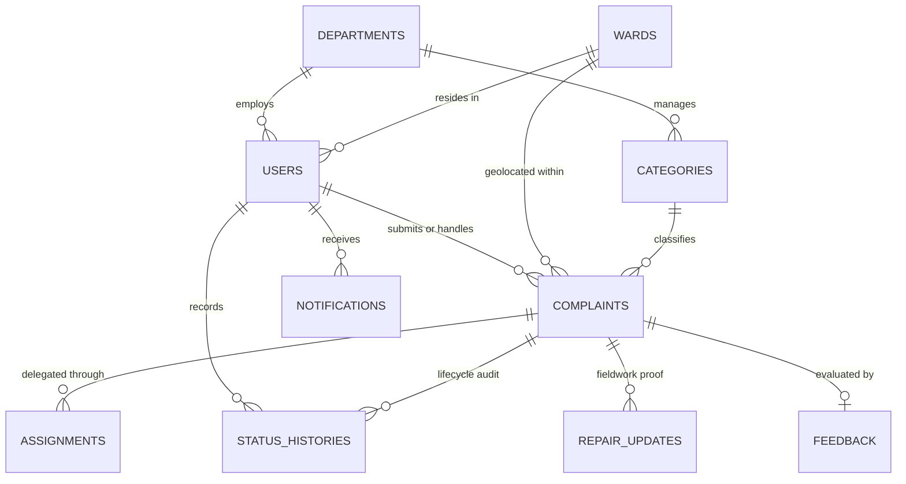

# CivicFix – MongoDB Document Database Architectural Documentation

## 1. Executive Summary
**CivicFix** is engineered using **MongoDB** as its primary operational document database. The system utilizes a flexible yet strictly validated document model, multi-stage aggregation pipelines, compound indexing, and atomic multi-document transactions to power the complaint resolution lifecycle.

---

## 2. Document Collections & Relationships

---

## 3. Document Collections Catalog

| Collection Name | Key Fields & Types | Indexes & Constraints |
| :--- | :--- | :--- |
| **`users`** | `_id`, `email`, `password`, `role`, `fullName`, `phone`, `wardId`, `departmentId`, `employeeCode`, `ratingAvg` | `UNIQUE(email)`, `INDEX(role)`, `SPARSE(employeeCode)` |
| **`departments`** | `_id`, `name`, `code`, `description`, `headName`, `contactEmail`, `helplineNumber`, `budgetAllocated` | `UNIQUE(code)`, `UNIQUE(name)` |
| **`wards`** | `_id`, `wardNumber`, `name`, `zone`, `councillorName`, `councillorPhone`, `population`, `areaSqKm` | `UNIQUE(wardNumber)`, `INDEX(zone)` |
| **`categories`** | `_id`, `name`, `departmentId`, `defaultSlaHours`, `severityLevel`, `iconName` | `UNIQUE(name)`, `INDEX(departmentId)` |
| **`complaints`** | `_id`, `complaintCode`, `citizenId`, `categoryId`, `wardId`, `title`, `description`, `locationAddress`, `priority`, `status`, `assignedWorkerId`, `submissionDate`, `resolutionDeadline` | `UNIQUE(complaintCode)`, `INDEX(status, priority)`, `INDEX(citizenId)`, `INDEX(assignedWorkerId)` |
| **`assignments`** | `_id`, `complaintId`, `workerId`, `assignedByAdminId`, `status`, `notes`, `assignedAt` | `INDEX(complaintId)`, `INDEX(workerId)` |
| **`statushistories`** | `_id`, `complaintId`, `previousStatus`, `newStatus`, `changedByUserId`, `remarks`, `changedAt` | `INDEX(complaintId, changedAt)` |
| **`repairupdates`** | `_id`, `complaintId`, `workerId`, `updateNotes`, `beforeImageUrl`, `afterImageUrl`, `materialsUsed`, `costIncurred` | `INDEX(complaintId)`, `INDEX(workerId)` |
| **`feedbacks`** | `_id`, `complaintId`, `citizenId`, `rating` (1–5), `satisfactionLevel`, `comments`, `submittedAt` | `UNIQUE(complaintId)`, `INDEX(rating)` |
| **`notifications`** | `_id`, `userId`, `complaintId`, `title`, `message`, `isRead`, `notificationType` | `INDEX(userId, isRead)` |

---

## 4. Key MongoDB Concepts Implemented

1. **Schema Validation (`$jsonSchema`)**:
   Ensures type safety, email regex checks, and enum validation at the database layer (defined in `mongo-init.js`).

2. **Multi-Stage Aggregation Pipelines (`$lookup`, `$facet`, `$group`)**:
   Replaces traditional SQL views and complex joins with high-performance native pipeline aggregations for dashboards and reports.

3. **Compound & Sparse Indexing**:
   Optimizes search queries across status, priority, and citizen ID for sub-millisecond query execution.

4. **Audit Trail Pattern**:
   Preserves full historical lifecycle state transitions in `statushistories` for complete municipal compliance.
